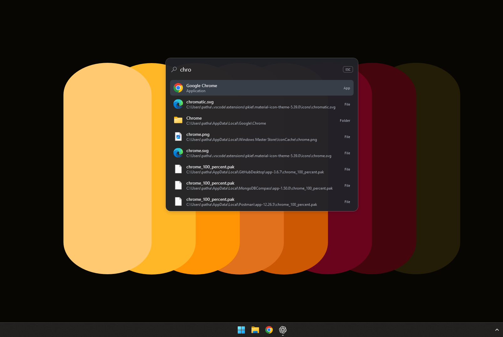
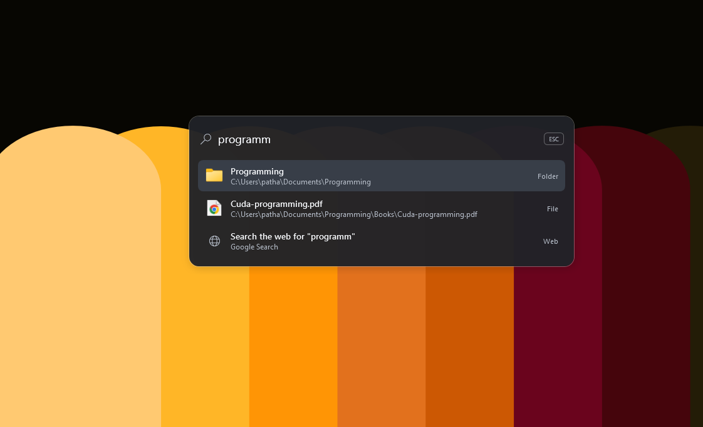

  

<h1 align="center">Finder</h1>

A quick way to find and open apps, files, folders, Windows settings, and web searches.

---

Finder is a small Windows search launcher that stays ready in the notification area. Bring it up with a keyboard shortcut, type what you are looking for, and open a result with the keyboard or mouse.

## Screenshots

Search for an installed app or a file by name:

  

Search across folders, files, and the web:

  

## Install Finder

1. Download **FinderSetup.msi** from the release and open it.
2. Read and accept the Finder license agreement to continue.
3. Follow the installer prompts. Finder installs for your Windows user and does not require administrator access.

Finder is installed in `%LOCALAPPDATA%\Programs\Finder`. The installer creates a Start Menu shortcut and, by default, starts Finder automatically when you sign in. To turn off automatic startup, disable Finder in Windows **Settings → Apps → Startup** after installation. Advanced: you can install without enabling automatic startup by running `msiexec /i FinderSetup.msi AUTOSTART=0` from the folder containing the installer.

To remove Finder, open **Settings → Apps → Installed apps**, select Finder, and choose **Uninstall**.

## Use Finder

- Press **Alt + Space** to open Finder. If another program already uses that shortcut, Finder tries **Ctrl + Alt + Space** instead. The active shortcut is shown in Finder’s notification-area menu.
- You can also open Finder from its notification-area icon. Right-click the icon and choose **Open Finder**.
- Type a few letters from an app, file, folder, or setting name. Matching results appear as you type.
- Use **Up** and **Down** to move through results, then press **Enter** to open the selected result. You can also click or double-click a result.
- Press **Esc** to hide Finder. Finder also hides after you open a result or click away from its window.

## What Finder can search

- **Apps:** Windows Start Menu shortcuts for your account and for all users.
- **Files and folders:** Your user profile and common folders such as Desktop, Documents, Downloads, Pictures, Music, and Videos. File search is a live, best-effort search rather than a full-disk index; each search is bounded to keep it responsive, so results beyond the scan limits may not appear.
- **Windows Settings:** Search for settings such as display, sound, network, Bluetooth, updates, storage, and startup apps.
- **Web:** Search the web or open a web address. When you choose a web search result, the query is sent to Google in your browser.

Finder follows your Windows app light or dark theme preference.

## System requirements

- 64-bit Windows 10 or later.
- The release installer includes the files needed to run Finder; a separate .NET installation is not required.

## License

Finder is provided under the license agreement shown during installation. The installed application and its third-party components may also be subject to their respective license terms.
